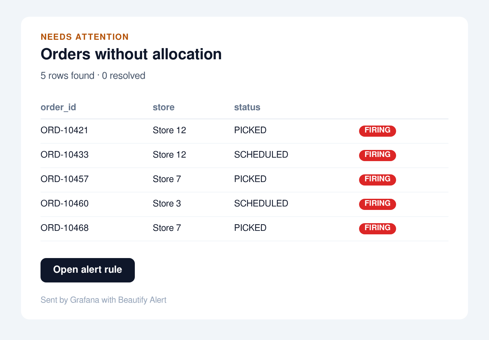
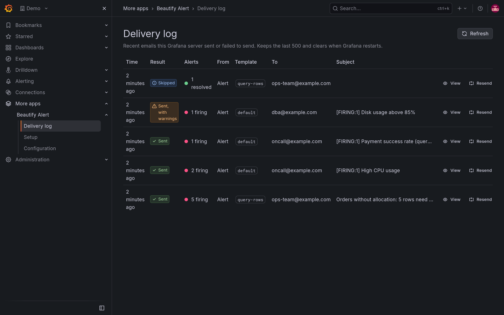
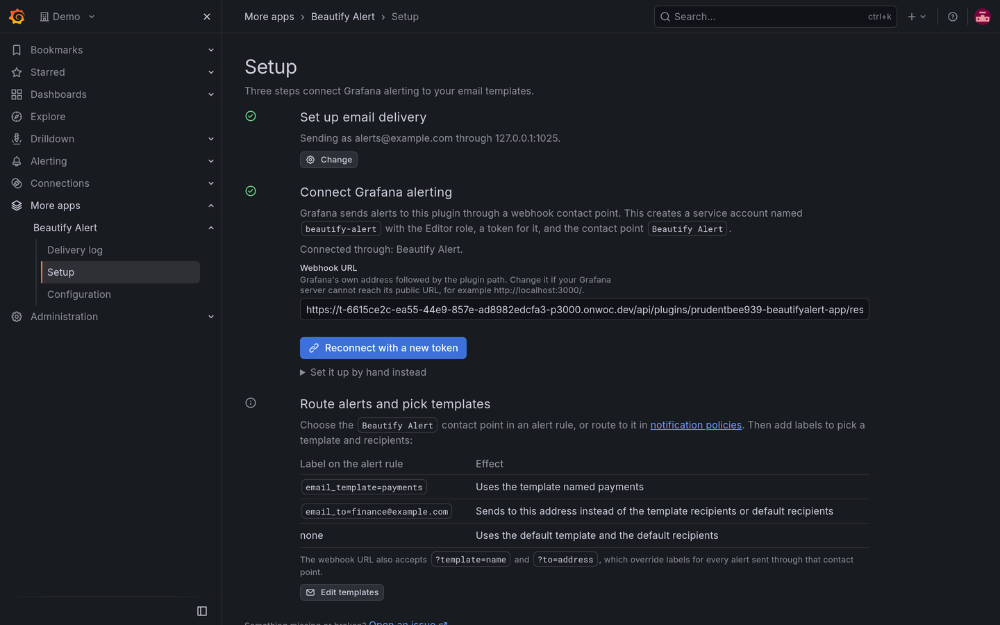
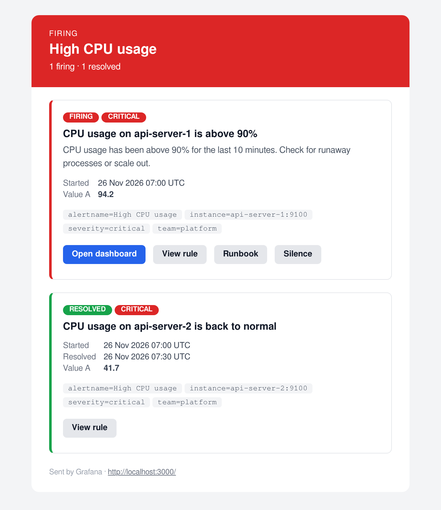
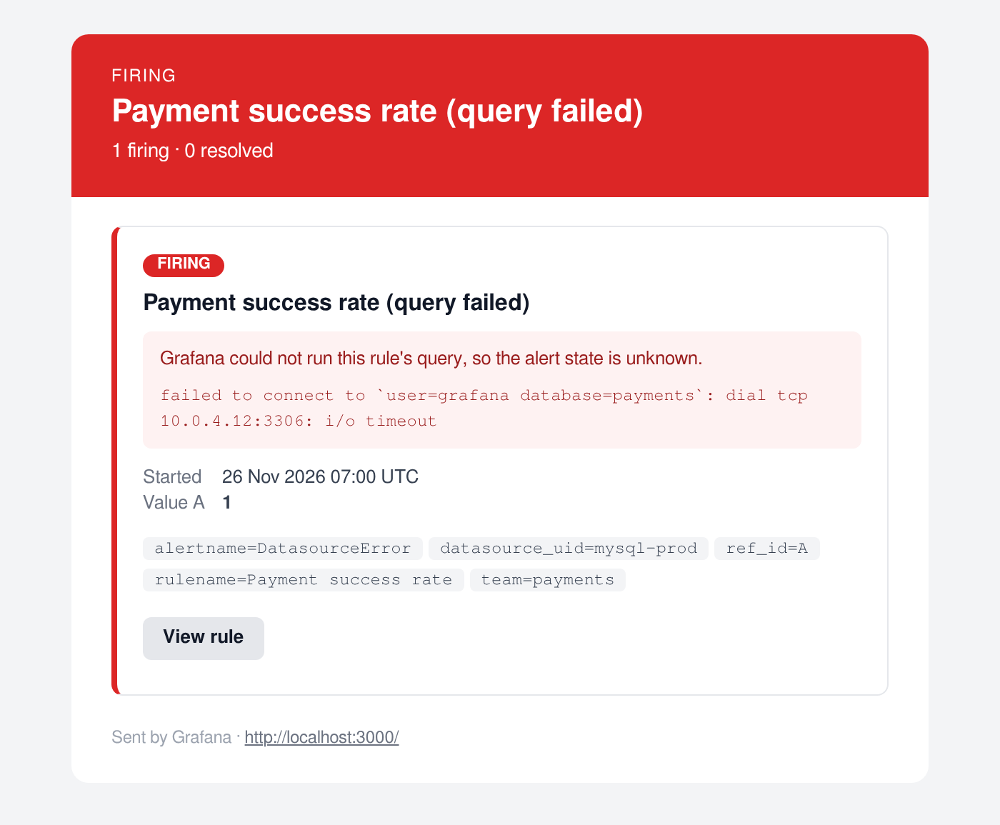

# Beautify Alert

**Designed HTML emails for Grafana alerts.** Write your own email templates in HTML and CSS, pick one per alert with a label, preview it live, and send it through any SMTP server.

[](https://github.com/MiteshDhangar/beautify-alert/releases)
[](https://github.com/MiteshDhangar/beautify-alert/actions/workflows/ci.yml)
[](LICENSE)


Beautify Alert is a free, open-source Grafana app plugin for anyone who runs Grafana alerting. It is not tied to any company or product.

| Template editor | Email it sends |
| --- | --- |
|  |  |

## Why

Grafana's email contact point lets you change the subject and the text of an alert email, but not its layout: HTML in notification templates is escaped, so every alert email looks the same. Beautify Alert renders alerts with your own HTML instead, so you can send:

- a branded email to customers or management,
- a table of the rows a SQL alert found (orders, hosts, payments),
- a compact one-line-per-alert digest for a busy on-call inbox,
- a clear "the check could not run" email when a query fails, instead of `DatasourceError`.

## Features

- **HTML and CSS templates** in Go template syntax, the same syntax as Grafana's notification templates. CSS in `<style>` is inlined so Gmail and Outlook show it.
- **A template per alert.** Add `email_template=payments` to an alert rule and its emails use the `payments` template.
- **Recipients per alert or per template**, with a default list.
- **Live preview** with sample firing and resolved alerts, and **test emails**.
- **Starter templates:** cards, compact table, summary for stakeholders, blank.
- **One-click setup** of the service account, token and webhook contact point.
- **Delivery log** of every email sent, failed or skipped, with errors, warnings, a full view of the email and **resend**.
- **Safe delivery:** invalid addresses are skipped instead of blocking the email, a template that breaks on real data falls back to the built-in layout, and short SMTP failures are retried.
- **Large alert groups** list up to 40 alerts per email (configurable) and say how many more there are.
- **Time-window rules:** turn off resolved-only emails per template.
- **Threading:** firing and resolved emails of one alert group are linked as one conversation.
- **Templates as code** through Grafana provisioning.
- **Per-organization** settings and delivery log.

## Quick start

1. **Install** the plugin ([getting started](docs/getting-started.md#install)).
2. **Configure email:** Administration, Plugins, Beautify Alert, Configuration. Enter your SMTP server, click **Test connection**, then **Save settings**. Recipes for Gmail, Amazon SES, SendGrid, Mailgun and others are in [configuration](docs/configuration.md#smtp-providers).
3. **Connect alerting:** open Beautify Alert, **Setup**, and click **Create contact point**.
4. **Route alerts:** pick the **Beautify Alert** contact point in an alert rule, or route to it in a notification policy.
5. **Pick a template:** create one on the **Templates** page and add `email_template=<name>` to the alert rule.

That's it. The rule's next notification arrives as your HTML email, and appears in the **Delivery log**.

## How it works

```
Alert rule ──► Grafana alerting ──► Webhook contact point ──► Beautify Alert ──► SMTP ──► Inbox
  labels pick      (notification         (service account          picks the template,
  the template      policies)             token)                   renders and sends
```

Grafana plugins cannot add new contact point types, so Grafana sends alerts to the plugin through its built-in webhook contact point. The Setup page creates that contact point for you. Details: [architecture](docs/architecture.md).

## Documentation

| Guide | What it covers |
| --- | --- |
| [Getting started](docs/getting-started.md) | Install, configure, connect and send your first email, step by step |
| [Configuration](docs/configuration.md) | Every setting, and SMTP settings for Gmail, Microsoft 365, Amazon SES, SendGrid, Mailgun, Postmark and local relays |
| [Routing alerts](docs/routing.md) | How alerts pick a template and recipients, with notification policy examples |
| [Creating templates](docs/creating-templates.md) | Write your own template, with examples |
| [Template reference](docs/templates.md) | Every field and function available in templates |
| [Examples](examples/) | Ready-to-use templates and a provisioning file |
| [Provisioning](docs/provisioning.md) | Keep settings and templates in Git |
| [Troubleshooting](docs/troubleshooting.md) | No email, SMTP errors, Gmail clipping, permissions |
| [Architecture](docs/architecture.md) | How the plugin is built, endpoints, security |

## Screenshots

| | |
| --- | --- |
|  |  |
| **Delivery log** with sent, warning and skipped emails | **Setup** creates the contact point in one click |
|  |  |
| **Default template** | **Query failure** names the rule and shows the error |

## FAQ

**Does it replace Grafana's email contact point?** No, it adds a second way to send email. Your existing contact points keep working. You choose per alert rule or per notification policy which alerts go through Beautify Alert.

**Which Grafana versions?** Grafana 13.2 or later, self-hosted (OSS or Enterprise). Grafana Cloud has not been tested yet.

**Does it use Grafana's `[smtp]` settings?** No. It has its own SMTP settings on its Configuration page, stored encrypted by Grafana.

**Can I use my existing Grafana notification templates?** The fields are the same (`.Alerts`, `.CommonLabels`, `.Labels`, `.Annotations`, ...), so most template code works. Named templates defined in Grafana's alerting UI are not loaded.

**How many templates can I have?** Grafana stores at most 64 KB of settings per plugin. Templates are saved compressed, which fits about 50 typical templates. The Templates page shows how much is used.

**Does Grafana retry failed emails?** Grafana's webhook contact point does not retry, so the plugin retries short SMTP failures itself. Anything that still fails can be resent from the delivery log.

**Does it collect any data?** No. The plugin sends nothing anywhere except your emails to your SMTP server.

## Roadmap

More email providers (Microsoft 365 with OAuth, Amazon SES and SendGrid APIs), previews with real alert data, charts and query results in emails, and Slack and Teams layouts. See the [roadmap](ROADMAP.md) and vote in [issues](https://github.com/MiteshDhangar/beautify-alert/issues).

## Contributing

Bug reports, templates and code are welcome. See [CONTRIBUTING.md](CONTRIBUTING.md). To develop locally:

```bash
npm install && npm run dev          # frontend, rebuilds on change
mage -v build:linux                 # backend, rerun after Go changes
docker compose up                   # Grafana on :3000 and Mailpit on :8025
```

Every email the local Grafana sends appears in Mailpit at http://localhost:8025.

## License

[Apache 2.0](LICENSE). Made by [Mitesh Dhangar](https://github.com/MiteshDhangar).
