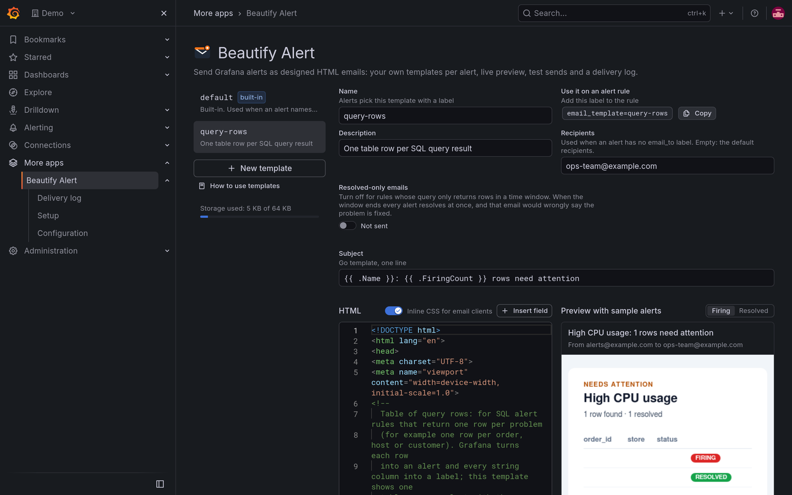

# Beautify Alert

Send Grafana alerts as designed HTML emails.

Grafana's email contact point lets you change the subject and the text of an alert email, but not its layout: HTML in notification templates is escaped. Beautify Alert is a Grafana app plugin that renders each alert with an HTML template you write, picked per alert with a label, and sends it through your SMTP server.



## Features

- **HTML templates.** Write full HTML and CSS with Go templates, the same syntax as Grafana's own notification templates. CSS in `<style>` is moved into `style` attributes before sending, so Gmail and Outlook show it.
- **One template per alert.** Add the label `email_template=payments` to an alert rule and its emails use the `payments` template. Alerts without the label use `default`.
- **Recipients per alert or per template.** The `email_to` label, the template's own recipients, or the default list, in that order.
- **Live preview and test emails.** See the email update as you type, with firing and resolved sample alerts, then send a test to your inbox.
- **Starter templates.** Cards, compact table, summary for stakeholders, and blank.
- **One-click setup.** The Setup page creates the service account, its token and the webhook contact point for you.
- **Delivery log.** Every email sent or failed, with the error, a full view of the email and a resend button.
- **Email threading.** The firing and resolved emails of one alert group carry the same `References` header, so mail clients can show them as one conversation.
- **Templates as code.** Templates and settings can be provisioned from YAML and kept in Git.

## How it works

```
Alert rule ──► Grafana alerting ──► Webhook contact point ──► Beautify Alert backend ──► SMTP ──► Inbox
               (labels pick the                (service account          (picks template,
                template)                        token)                   renders, sends)
```

Grafana plugins cannot add new contact point types, so the plugin receives alerts from Grafana's own webhook contact point at `/api/plugins/prudentbee939-beautifyalert-app/resources/alert`. Grafana authenticates that call with a service account token. See [docs/architecture.md](docs/architecture.md).

## Requirements

- Grafana 13.2 or later, self-hosted (OSS or Enterprise).
- An SMTP server the Grafana server can reach.

## Install

Until the plugin is in the Grafana catalog, install it from a release zip:

```bash
unzip prudentbee939-beautifyalert-app-<version>.zip -d /var/lib/grafana/plugins/
```

Allow it as an unsigned plugin in `grafana.ini`, then restart Grafana:

```ini
[plugins]
allow_loading_unsigned_plugins = prudentbee939-beautifyalert-app
```

## Set up

1. **Configuration:** open Administration, Plugins, Beautify Alert, Configuration. Enter the SMTP host, port, security, login and the from address. Click **Test connection**, then **Save settings**.
2. **Setup page:** open Beautify Alert, Setup, and click **Create contact point**. If the Grafana server cannot reach its own public URL, change the webhook URL to one it can reach, such as `http://localhost:3000/api/plugins/prudentbee939-beautifyalert-app/resources/alert`.
3. **Route alerts:** pick the `Beautify Alert` contact point in an alert rule, or route to it in a notification policy.
4. **Templates:** create a template, then add `email_template=<name>` to the alert rules that should use it.

## Choosing a template and recipients

For each alert in a notification:

| | First match wins |
| --- | --- |
| Template | `?template=` on the webhook URL, the `email_template` label, the `email_template` annotation, `default` |
| Recipients | `?to=` on the webhook URL, the `email_to` label, the `email_to` annotation, the template's recipients, the default recipients |

Alerts that end up with the same template and recipients are sent as one email. Both label names can be changed on the Configuration page.

Example: a notification has three alerts. Two have `email_template=payments`, one has no label. The plugin sends two emails: the `payments` email with two alerts to the `payments` template's recipients, and the `default` email with one alert to the default recipients.

## Writing templates

```html
<h2 style="color: {{ statusColor .Status }}">{{ .CommonLabels.alertname }}</h2>
{{ range .Alerts }}
  <p>{{ .Annotations.summary }}, started {{ since .StartsAt }} ago</p>
  <a href="{{ .DashboardURL }}">Open dashboard</a>
{{ end }}
```

Values from alerts are HTML-escaped. The template reference lists every field and function: [docs/templates.md](docs/templates.md).

## Development

```bash
npm install
npm run dev            # frontend, rebuilds on change
mage -v build:linux    # backend, rerun after Go changes
npm run server         # Grafana plus Mailpit in Docker
```

Grafana runs at http://localhost:3000 and the emails it sends appear in Mailpit at http://localhost:8025.

Tests:

```bash
go test ./pkg/...      # backend
npm run test:ci        # frontend unit tests
npm run e2e            # browser tests against the running Grafana
```

See [CONTRIBUTING.md](CONTRIBUTING.md) and the [roadmap](ROADMAP.md).

## License

Apache 2.0. See [LICENSE](LICENSE).
